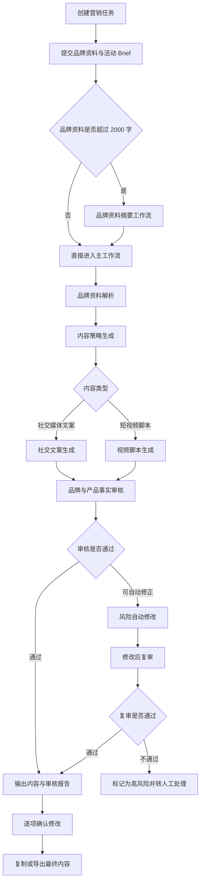

# BrandFlow AI

> 品牌内容生产与风险审核 Agent：把「找资料 → 写内容 → 人工检查 → 反复改稿」的分散流程，变成「品牌理解 → 内容生成 → 自动初审 → 人工终审」的可追溯工作流。

    

BrandFlow AI 是一个面向中小品牌、广告公司与内容团队的品牌内容生成与辅助审核 Web 应用。用户提交品牌资料和营销任务（Brief）后，服务端调用 Coze 工作流，返回社交媒体文案或短视频脚本，并附带品牌一致性审核报告与风险修正记录。AI 负责初稿、初审和修改建议；人负责最终产品事实、品牌表达和平台规范的发布确认。

## 为什么做这个项目

品牌内容团队使用通用大模型时经常遇到三个问题：

1. **品牌资料分散，模型不理解品牌**：品牌手册、产品资料、禁用词散落在不同文档，每次生成都要重复粘贴背景；
2. **一份 Brief 要为不同平台反复改写**：小红书、抖音、公众号的内容结构、语气、节奏各不相同；
3. **生成之后缺少可解释的审核与修改闭环**：内容可能出现未经证实的产品功效、虚构体验或绝对化用语，而普通聊天工具无法说明「哪里有问题、为什么、怎么被修改」。

BrandFlow 的核心回答是：**可控顺序型多阶段工作流（Workflow Agent）**——策略 → 创作 → 审核 → 修正 → 复审，每一步可测试、可解释、可追溯。

## 目录

- [已实现功能](#已实现功能)
- [产品主流程](#产品主流程)
- [Agent 审核与修正闭环](#agent-审核与修正闭环)
- [本地启动](#本地启动)
- [Coze 配置](#coze-配置)
- [质量检查](#质量检查)
- [项目结构](#项目结构)
- [MVP 边界与路线图](#mvp-边界与路线图)
- [相关文档](#相关文档)

## 已实现功能

- 中文任务创建页，支持社交媒体文案与短视频脚本的条件表单
- 必填字段及内容数量的前端、服务端双重校验
- `POST /api/generate` 服务端接口，凭据不会发送到浏览器
- Coze `stream_run` SSE 响应解析，忽略 PING，解析 `Message.content`
- 超时、鉴权、上游工作流和 JSON 解析错误处理
- 不伪造内部节点完成结果的生成阶段动画
- 社交内容、视频分镜、风险等级和审核报告展示
- 最终内容与审核报告支持 JSON 字符串自动解析及纯文本回退
- 人工审核确认后才允许复制最终内容
- 每篇内容可独立编辑、保存会话草稿、复制、重新生成和局部修正
- 编辑后的内容可调用独立 Coze 审核工作流重新审核
- 高风险红线阻断复制，并提供风险分级说明
- 支持展示修改前后差异、修正方式和人工确认状态
- 支持图片、Logo、短视频及 PDF 上传预览，并将人工确认的视觉事实传入生成流程
- 提供可选 AI 配图/版权图库服务接口，素材必须包含来源和授权信息
- 桌面端优先并适配手机、平板布局
- 服务端异步任务 + 文件持久化 + 前端轮询，关闭页面后可恢复任务
- 品牌资料超 2000 字时先经独立摘要工作流压缩上下文，失败安全回退原文
- 独立离线评测工具（`evals/`）：20 条固定样本自动检查必含信息、禁用表达、风险状态与任务完成情况

## 产品主流程



## Agent 审核与修正闭环

审核 Agent 不只检查错别字或敏感词，还会结构化检查产品事实与风险表达：

| 风险类型 | 不合格示例 | 处理方式 |
| --- | --- | --- |
| 虚构长期体验 | 「用了三个月没有磨损」 | 删除或改为已确认的概括卖点 |
| 虚构第三方评价 | 「店员都夸好看」 | 删除第三方背书 |
| 未证实产品功效 | 「减少视觉疲劳」「保护视力」 | 阻断或改为客观参数 |
| 未证实使用场景 | 「热美式也能装」 | 改为中性描述 |
| 绝对化表达 | 「全网最好」「完美适配」 | 改为克制表达 |
| 能力扩大 | 便携餐具写成「减少一次性餐盒」 | 回到明确的产品事实 |

流程不是「审核 → 修改 → 直接结束」，而是 **审核发现问题 → 自动修改 → 修改后复审 → 通过才交付；不通过则转人工**。服务端还有一层红线检查：若复审失败、风险仍高或审核配置异常，系统使用保守策略，阻断复制并标记为「等待人工处理」。结果页设计了两层人工机制：逐项确认修改、发布责任确认。

## 本地启动

要求：Node.js 20.9 或更高版本。

```bash
npm install
copy .env.example .env.local
npm run dev
```

打开 [http://localhost:3010](http://localhost:3010)。BrandFlow 固定使用独立端口 `3010`，避免与其他本地项目冲突。macOS/Linux 请使用 `cp .env.example .env.local`。

## Coze 配置

编辑 `.env.local`，填入 Coze 工作流页面提供的信息：

```env
COZE_API_TOKEN=your_real_token
COZE_WORKFLOW_ID=your_workflow_id
COZE_SUMMARY_WORKFLOW_ID=your_brand_summary_workflow_id
COZE_REVIEW_WORKFLOW_ID=your_review_workflow_id
COZE_ITEM_REVISE_WORKFLOW_ID=your_item_revise_workflow_id
```

默认请求 `https://api.coze.com/v1/workflow/stream_run`。如使用其他区域或私有部署，可通过 `COZE_API_BASE_URL` 覆盖基础地址。真实 token 只在服务端读取，`.env*` 已被 Git 忽略（`.env.example` 除外）。

Coze 工作流的最终 `Message.content` 应为可解析的 JSON，并建议包含：

```json
{
  "final_content": {},
  "review_result": "通过",
  "revision_result": false,
  "risk_level": "低",
  "review_report": {},
  "human_review_req": true
}
```

`final_content` 与 `review_report` 也可以是 JSON 字符串。结构不匹配时，界面会回退为普通文本展示。

如需启用编辑后的「重新审核」，请将独立审核工作流 ID 配置到 `COZE_REVIEW_WORKFLOW_ID`。如需启用配图服务，可配置：

```env
BRANDFLOW_IMAGE_PROVIDER_URL=https://your-provider.example/api/assets
BRANDFLOW_IMAGE_PROVIDER_TOKEN=optional_server_token
```

配图接口建议返回 `{ "assets": [{ "id", "url", "thumbnailUrl", "source", "license", "attribution" }] }`。没有配置供应商时，界面会明确提示，不会伪造图片或授权信息。

## 质量检查

```bash
npm run lint
npm run typecheck
npm test
npm run build
```

## 项目结构

```
brandflow-ai/
├── src/
│   ├── app/                # 页面与 API Route Handlers
│   │   ├── api/
│   │   │   ├── generate/   # 创建生成任务
│   │   │   ├── item-action/ # 单项局部修正
│   │   │   ├── review/     # 编辑后重新审核
│   │   │   ├── tasks/      # 任务查询与恢复
│   │   │   └── visual-assets/ # 配图/版权图库服务
│   │   ├── generating/     # 生成进度页
│   │   └── result/         # 结果与审核报告页
│   ├── components/
│   │   ├── task-form/      # 任务表单（品牌资料、Brief、素材上传）
│   │   ├── generation/     # 生成进度组件
│   │   ├── result/         # 内容渲染、审核报告、修改差异、配图面板
│   │   ├── task-recovery/  # 任务恢复
│   │   └── app-shell/      # 应用外壳
│   ├── lib/
│   │   ├── server/         # Coze 流式调用、任务存储、摘要、红线审核
│   │   └── input-limits.ts / result-utils.ts / storage.ts
│   └── types/              # 品牌与审核类型定义
├── tests/                  # Vitest 单元测试
├── evals/                  # 离线评测工具（20 条固定样本）
└── docs/                   # 产品方案与作品集文档
```

## MVP 边界与路线图

### 当前 MVP 边界

当前版本不包含数据库、登录、支付、复杂权限、完整任务历史页面、品牌库或团队协作。生成任务保存在 `.brandflow-data/tasks`，浏览器通过 `localStorage` 保存当前任务编号；关闭页面后可以恢复任务。若本地服务进程中断，重新访问未完成任务时会根据已保存的请求重新执行。

当品牌资料超过 2000 字时，服务端会先调用独立摘要工作流压缩上下文，再把摘要传入主工作流。任务记录和修改后复审仍保留并使用用户提交的原始品牌资料；摘要工作流失败、返回空内容或没有实现有效压缩时，系统会记录警告并安全回退到原文。

### 下一步路线图

| 优先级 | 方向 | 目标 |
| --- | --- | --- |
| P1 | 数据库与账号体系 | 支持任务历史、品牌库、多人协作 |
| P1 | Prompt / Workflow 版本管理 | 追踪生成结果对应的规则版本 |
| P1 | 审核可观测性 | 记录耗时、失败率、模型调用与风险命中率 |
| P2 | 品牌知识库 | 将历史品牌资料、产品手册转为可检索知识 |
| P2 | 平台发布接口 | 在人工确认后对接平台发布能力 |
| P2 | 内容效果分析 | 建立发布后的互动与转化反馈闭环 |

## 相关文档

- [`docs/Notion_作品集_BrandFlow_AI.md`](docs/Notion_作品集_BrandFlow_AI.md)：完整产品方案——问题定义、Agent/工作流设计、审核决策逻辑、系统架构、API 数据契约、测试案例（AERI Fold 折叠桌面灯示例）、关键产品决策与作品集说明。
- [`evals/README.md`](evals/README.md)：离线评测工具运行说明。

---

> 本项目只使用虚构品牌和测试数据展示流程；真实品牌资料、Token 与私密配置均不应公开上传。
