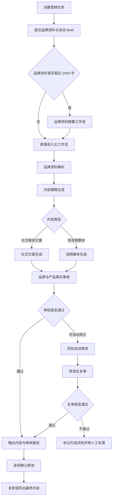
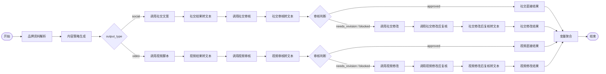
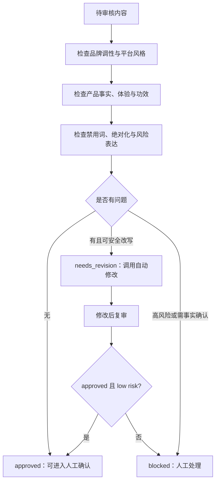
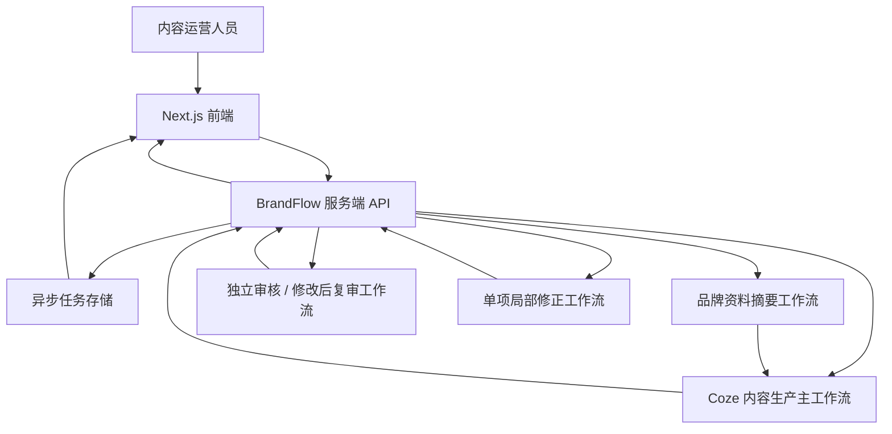

# BrandFlow AI｜品牌内容生产与风险审核 Agent

> **项目定位**：面向中小品牌、广告公司与内容团队的 AI 内容生产与辅助审核系统。用户提交品牌资料和营销 Brief 后，系统完成品牌理解、内容策略生成、社交文案/短视频脚本创作、风险审核、自动修正与人工确认。


---

## 项目速览

| 项目项 | 内容 |
| --- | --- |
| 项目名称 | BrandFlow AI |
| 项目类型 | Workflow Agent / AI Agent 应用 |
| 服务对象 | 品牌运营人员、广告代理商策划、内容团队 |
| 核心场景 | 品牌活动内容生产、品牌一致性审核、内容风险修正 |
| 内容输出 | 社交媒体文案、短视频分镜脚本、审核报告、修改记录 |
| 技术实现 | Next.js + TypeScript + Tailwind CSS + Coze Workflow + 服务端 API |
| Agent 形态 | 可控顺序型多阶段工作流；不是完全自主规划型 Agent |
| 当前版本 | MVP：AI 初稿 + 自动初审 + 人工终审 |

---

## 1. 我想解决什么问题？

品牌内容团队使用通用大模型时，经常会遇到三个问题：

1. **品牌资料分散，模型不理解品牌。**
   
   品牌手册、产品资料、历史文案、禁用词和用户画像散落在不同文档中。运营人员每次生成内容都要重复粘贴背景，且很难保证输入完整。

2. **一份活动 Brief 要为不同平台反复改写。**
   
   小红书、抖音、公众号等平台的内容结构、语气、节奏和 CTA 都不同；直接复制同一份文案通常不成立。

3. **生成之后缺少可解释的审核与修改闭环。**
   
   内容可能出现未经证实的产品功效、虚构用户体验、绝对化用语或不符合品牌调性的表达。普通聊天工具只负责“生成”，无法说明“哪里有问题、为什么有问题、怎么被修改”。

### 一句话价值主张

> 把“找资料 → 写内容 → 人工检查 → 反复改稿”的分散流程，变成“品牌理解 → 内容生成 → 自动初审 → 人工终审”的可追溯工作流。

---

## 2. 目标用户与核心场景

### 核心用户

**中小品牌内容运营人员**：需要持续生产社交内容，熟悉品牌但没有时间反复整理资料和改写多平台文案。

**广告公司 / 内容代理商策划人员**：需要同时服务多个客户品牌，难点是不同品牌之间的表达规范容易混淆。

### 核心使用场景

用户为一次营销活动创建任务，例如：

> 为一个桌面照明品牌的“小空间书桌焕新计划”，生成 3 篇小红书文案或一条 30 秒视频脚本，并检查是否包含未经证实的“护眼”“无频闪”“减少视觉疲劳”等功效承诺。

系统输出：

- 结构化品牌档案与内容方向；
- 社交媒体文案或短视频分镜；
- 审核评分、问题位置与修改建议；
- 自动修改后的内容与差异记录；
- 必要时转人工确认。

---

## 3. 产品主流程



> Notion 提示：Notion 原生 Markdown 不一定自动渲染 Mermaid。可以保留这段作为代码块，并在下方插入 Coze 主工作流截图；也可以使用 Mermaid Chart 等第三方嵌入块将图表渲染出来。

### 用户体验流程

```text
填写品牌与活动信息
→ 选择“社交文案”或“短视频脚本”
→ 系统异步生成并显示进度
→ 查看内容、审核结论和修改差异
→ 对每条自动修改逐项确认
→ 完成人工责任确认后复制内容
```

---

## 4. Agent / 工作流设计

### 4.1 为什么它属于 Agent 项目？

它不是“用户提问 → 大模型回答”的单次聊天应用，而是围绕一个明确业务目标，执行多阶段任务、在结果之间传递上下文、根据审核结果选择下一步动作：

```text
目标：生成符合品牌规范、可供人工发布确认的营销内容

品牌理解
→ 策略规划
→ 内容创作
→ 审核判断
→ 自动修正或人工阻断
→ 最终交付
```

因此更准确的分类是：

> **Workflow Agent（工作流型 Agent）/ AI Agent 应用**

我选择固定、可控的编排，而不是让模型自由决定所有步骤，原因是品牌内容涉及产品事实与风险表达，第一版需要优先保证可测试、可解释和可追溯。

### 4.2 工作流模块拆分

| 模块 | 输入 | 主要职责 | 输出 |
| --- | --- | --- | --- |
| 品牌资料摘要 | 超长品牌资料 | 压缩上下文，保留关键事实 | 结构化/压缩后的品牌资料 |
| 品牌资料解析 | 品牌名称、行业、资料 | 提取定位、语气、受众、卖点、禁用表达 | 品牌档案 |
| 内容策略生成 | 品牌档案、活动 Brief | 生成传播主题、内容方向、CTA | 内容策略 |
| 社交文案生成 | 品牌档案、策略、平台 | 生成标题、正文、标签、CTA、视觉建议 | 文案列表 |
| 视频脚本生成 | 品牌档案、策略、时长 | 生成钩子、分镜、旁白、字幕、拍摄清单 | 视频脚本 |
| 内容审核 | 内容 + 品牌事实 | 检查语气、平台适配、产品事实、绝对化表达 | 审核报告 |
| 风险自动修改 | 原内容 + 审核问题 | 删除/改写可安全修正的问题 | 修改后内容、变更记录 |
| 修改后复审 | 修改后内容 | 复核是否仍有风险 | 通过 / 阻断 / 人工处理 |

### 4.3 Coze 主工作流可视化



### 4.4 审核与自动修正的决策逻辑



---

## 5. 关键产品规则与风险控制

### 5.1 产品事实审核：不让“生活化文案”变成虚构事实

审核 Agent 不只检查错别字或敏感词，还会检查以下问题：

| 风险类型 | 不合格示例 | 原因 | 处理方式 |
| --- | --- | --- | --- |
| 虚构长期体验 | “用了三个月没有磨损” | 未提供真实用户或耐久测试依据 | 删除或改为已确认的概括卖点 |
| 虚构第三方评价 | “店员都夸好看” | 未提供真实评价来源 | 删除第三方背书 |
| 未证实产品功效 | “减少视觉疲劳”“保护视力” | 可能构成功效承诺 | 阻断或改为客观参数 |
| 未证实使用场景 | “热美式也能装”“可放入包侧袋” | 未确认耐热或尺寸信息 | 改为中性描述 |
| 绝对化表达 | “全网最好”“完美适配” | 不符合品牌克制语气，且可能违规 | 改为“可以”“更适合”等克制表达 |
| 能力扩大 | 把便携餐具写成“减少一次性餐盒” | 产品功能被扩大 | 回到明确的产品事实 |

### 5.2 人机协同而非“无人发布”

产品不把 AI 审核当作最终发布许可。结果页设计了两层人工机制：

1. **逐项确认修改**：每一条自动修改都需要用户确认，未全部确认时无法复制。
2. **发布责任确认**：用户确认已阅读风险项与发布责任。

这使产品定位保持为：

> AI 负责初稿、初审和修改建议；人负责最终产品事实、品牌表达和平台规范的发布确认。

### 5.3 修改后再次审核

自动修改本身也可能引入新问题，因此流程不是“审核 → 修改 → 直接结束”，而是：

```text
审核发现问题
→ 自动修改
→ 修改后复审
→ 通过才交付；不通过则转人工
```

服务端还有一层红线检查。若复审失败、风险仍高或审核配置异常，系统使用保守策略：阻断复制并标记为“等待人工处理”。

---

## 6. 系统架构



### 技术选型

| 层级 | 技术 | 选择原因 |
| --- | --- | --- |
| 前端 | Next.js + React + TypeScript | 同时支持页面和服务端接口，类型安全，便于产品化迭代 |
| UI | Tailwind CSS + Lucide | 快速构建中文 SaaS 工作台与状态组件 |
| Agent 编排 | Coze Workflow | 适合快速验证多阶段 LLM 流程和分支逻辑 |
| 服务端调用 | Next.js Route Handlers | Coze Token 保留在服务端，不暴露给浏览器 |
| 流式解析 | SSE / stream_run | 忽略 PING 心跳，读取最终 Message.content |
| 本地任务恢复 | 文件任务存储 + localStorage | MVP 阶段实现异步任务、刷新恢复与失败重试 |
| 测试 | Vitest | 覆盖输入校验、摘要回退、任务存储、审核红线与结果解析 |

### 为什么需要服务端，而不是前端直接调 Coze？

```text
错误方式：浏览器 → Coze API
问题：Token 会暴露，无法统一处理任务记录、重试和错误日志

正确方式：浏览器 → BrandFlow 服务端 → Coze API
价值：Token 安全、可记录状态、可恢复任务、可实现多层审核
```

---

## 7. 核心交互与页面设计

### 7.1 创建任务页

用户填写：

- 品牌名称、行业与品牌资料；
- 活动名称、营销目标、核心产品事实；
- 发布平台；
- 输出类型：社交媒体文案 / 短视频脚本；
- 指定内容方向、必须包含与禁止出现的信息；
- 补充要求与视觉素材。

交互设计：

- “社交媒体文案”和“短视频脚本”通过卡片选择；
- 社交模式显示内容数量；视频模式显示视频时长与形式；
- 长文本字段有字数统计、2000 字预警和 3000 字硬限制；
- 前端和服务端双重校验，避免绕过。

**建议插图位置：** 创建任务页截图。

### 7.2 生成进度页

向用户呈现：

```text
解析品牌资料 → 生成内容策略 → 生成内容 → 品牌一致性审核 → 风险修正 → 完成
```

注意：前端仅展示合理的阶段性进度，不伪造 Coze 内部具体节点的实时完成状态。

**建议插图位置：** 正在生成页面截图。

### 7.3 结果与审核页

结果页展示：

- 社交文案：标题、正文、CTA、话题标签、视觉建议；
- 视频脚本：分镜、时间、画面、动作、旁白、字幕、转场；
- 审核摘要：综合评分、问题数量、审核结论；
- 问题卡片：原句、风险原因、依据、修改建议；
- 修改前后对比：原文、修改后文本、风险等级；
- 人工确认：逐项确认后才允许复制。

原始 JSON 被放进折叠区域，而不是直接展示给普通用户。

**建议插图位置：** 审核报告和修改差异截图。

---

## 8. 异步任务、失败恢复与输入摘要

### 8.1 为什么改成异步任务？

完整链路会连续调用多个模型节点，可能耗时数分钟。若浏览器直接同步等待，页面刷新、关闭或接口超时都会让用户误以为任务丢失。

最终设计：

```text
POST /api/generate
→ 创建 task_id
→ 服务端后台运行工作流
→ 持久化任务状态
→ 浏览器每 2 秒轮询任务
→ 成功、失败或恢复任务
```

任务状态：

```text
queued → summary → workflow → post_review → completed
                   ↘ failed
```

### 8.2 超长品牌资料处理

品牌资料过长会导致 Token 消耗增加、上下文重点丢失或工作流超时，因此做了两级控制：

```text
0–2000 字：直接进入主工作流
2001–3000 字：先由摘要工作流压缩，再进入主工作流
超过 3000 字：前端与服务端拒绝提交，并提示拆分资料
```

摘要保留：

- 品牌定位；
- 目标用户；
- 品牌语气；
- 已确认产品事实；
- 禁用表达。

如果摘要工作流未配置、失败、返回空内容、摘要过短或没有实现有效压缩，系统安全回退到原文，不做“硬截断”。原始资料继续用于任务记录和修改后复审。

---

## 9. API 与数据契约

### 9.1 输入参数（简化）

```json
{
  "brand_name": "AERI",
  "industry": "家居照明与桌面用品",
  "brand_material": "品牌定位、语气、目标受众与产品资料",
  "campaign_name": "小空间桌面焕新计划",
  "marketing_goal": "提升产品认知",
  "core_product": "已确认的产品事实与未确认能力",
  "platform": "小红书",
  "output_type": "social",
  "content_count": 3,
  "selected_dir": "租房书桌改造",
  "required_info": "必须包含的信息",
  "prohibited_info": "禁止出现的信息",
  "additional_req": "补充要求"
}
```

### 9.2 最终结果（简化）

```json
{
  "status": "success | partial_success",
  "output_type": "social | video",
  "content_type": "社交媒体文案 | 短视频脚本",
  "final_content": {},
  "review_result": "approved | needs_revision | blocked",
  "revision_result": "no_change | revised | blocked_need_human",
  "risk_level": "low | medium | high",
  "human_review_req": "yes | no",
  "review_report": {},
  "changes": []
}
```

### 9.3 状态映射

| 系统值 | 用户看到的文案 |
| --- | --- |
| `approved` | 已通过 |
| `needs_revision` | 发现问题 |
| `blocked` | 暂停发布 |
| `revised` | 已自动修改 |
| `no_change` | 无需修改 |
| `blocked_need_human` | 等待人工处理 |
| `low / medium / high` | 低 / 中 / 高风险 |

---

## 10. 测试案例与验证

### 示例品牌：AERI Fold 折叠桌面灯

已确认事实：

- 灯臂支持折叠调节；
- 三档亮度；
- 4000K 中性光；
- USB-C 充电；
- 黑色和白色版本。

未确认事实：

- 护眼、无频闪、零蓝光认证；
- 续航时长；
- 照射面积；
- App / 语音控制；
- 长期使用效果。

### 验证的关键 Bad Case

| 生成内容问题 | 系统预期处理 |
| --- | --- |
| “接近自然光，减少视觉疲劳” | 识别为未经证明的功效承诺，修改或阻断 |
| “最绝的是 USB-C 充电口” | 识别绝对化表达，改为中性说明 |
| “完美塞进小角落” | 识别为未证实的尺寸适配，改写或删除 |
| “收纳袋中取出产品” | 未确认配件，识别为虚构事实 |
| “用了三个月都没有磨损” | 识别为虚构长期体验 |
| 修改后仍出现高风险表达 | 进入 `blocked_need_human`，禁止复制 |

### 自动化验证

当前项目已覆盖：

- 请求参数校验；
- 长文本 3000 字限制；
- 智能摘要读取与失败回退；
- Coze 流式事件解析；
- 任务创建、持久化与恢复；
- 审核红线阻断；
- 修改后复审结果；
- 结果 JSON 解析与状态映射。

工程检查命令：

```bash
npm test
npm run typecheck
npm run lint
npm run build
```

---

## 11. 关键产品决策与取舍

### 决策 1：先做可控工作流，而不是完全自主 Agent

**原因**：品牌表达涉及事实准确性与合规风险。可控的“策略 → 创作 → 审核 → 修正”顺序更容易测试和解释。

**取舍**：灵活性低于自主规划 Agent，但可靠性、可追溯性和展示完整度更高。

### 决策 2：自动修改后必须复审

**原因**：自动修改本身可能引入新风险，不能默认修改即安全。

**取舍**：会增加一次模型调用和耗时，但避免“修完更错”的情况。

### 决策 3：不让 AI 审核替代人工发布责任

**原因**：模型无法保证所有产品事实、品牌策略和平台规范都正确。

**取舍**：用户多一步确认，但产品边界更真实，也更符合企业内容审核流程。

### 决策 4：超长资料摘要失败时回退原文

**原因**：硬截断可能丢失禁用词或产品事实；伪摘要比原文更危险。

**取舍**：少数情况下仍会使用较长上下文，但信息安全性优先。

---

## 12. 项目难点与我的解决方式

### 难点一：如何让“审核”不是一句空泛评价？

**解决**：将审核结果结构化为评分、问题位置、原文、原因、依据、风险等级和修改建议，并在页面中用问题卡片展示。

### 难点二：如何处理 Coze 工作流长时间运行？

**解决**：服务端异步任务 + 持久化状态 + 前端轮询 + 任务恢复，而不是让浏览器长时间同步等待。

### 难点三：自动修改如何避免绕开风险？

**解决**：增加修改后复审与服务端红线闸门；只要复审失败、配置异常或残留高风险，就转人工处理。

### 难点四：如何避免用户看不懂原始 JSON 审核结果？

**解决**：将机器字段映射为中文状态、审核摘要、分项评分、问题卡片和修改前后对比；原始 JSON 只放在折叠区供调试使用。

---

## 13. 当前边界与下一步计划

### 当前 MVP 边界

- 没有数据库和正式用户登录；
- 没有复杂权限、团队协作或品牌知识库管理；
- 不自动发布到社交平台；
- 不生成完整视频成片；
- 不将 AI 审核声明为法律或平台合规保证；
- 本地任务记录仅适用于 MVP 演示与单机使用。

### 下一步路线图

| 优先级 | 方向 | 目标 |
| --- | --- | --- |
| P1 | 数据库与账号体系 | 支持任务历史、品牌库、多人协作 |
| P1 | Prompt / Workflow 版本管理 | 追踪生成结果对应的规则版本 |
| P1 | 审核可观测性 | 记录耗时、失败率、模型调用与风险命中率 |
| P2 | 品牌知识库 | 将历史品牌资料、产品手册转为可检索知识 |
| P2 | 平台发布接口 | 在人工确认后对接平台发布能力 |
| P2 | 内容效果分析 | 建立发布后的互动与转化反馈闭环 |

---

## 14. 作品集展示建议

建议在 Notion 页面至少放 5 张图，按照用户旅程排布：

1. **封面 / 创建任务页**：展示品牌资料、内容类型与 Brief 输入。
2. **Coze 主工作流截图**：展示双分支、审核与修改后复审。
3. **生成进度页**：体现异步任务与状态恢复。
4. **结果页**：展示社交文案或视频分镜结构化输出。
5. **审核与修改对比页**：展示问题定位、自动修正与人工确认。

面试讲解可用 60 秒版本：

> 我做的是一个面向品牌内容团队的 Workflow Agent。它不是只生成文案，而是先把品牌资料提取成品牌规则，再根据营销 Brief 生成社交文案或视频脚本。为了降低 AI 内容风险，我加入了产品事实审核、可自动修正的风险修改，以及修改后复审；如果仍存在高风险，系统会阻断复制并转人工处理。前端用 Next.js 实现，Coze 负责工作流编排，服务端负责 Token 安全、异步任务恢复和最终红线检查。

---

## 15. 项目链接（按实际情况替换）

- 在线演示：`http://localhost:3010`（本地版本）
- 源码仓库：`待补充 GitHub 链接`
- 产品演示视频：`待补充`
- Coze 工作流截图：`待补充`

> 本项目只使用虚构品牌和测试数据展示流程；真实品牌资料、Token 与私密配置均不应公开上传。
